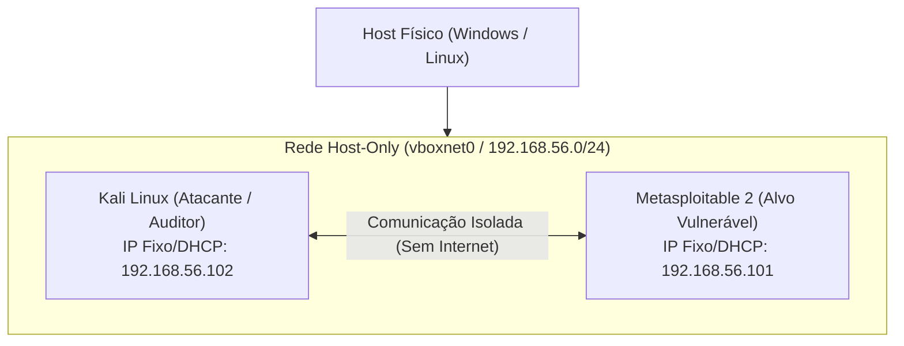

# 🖥️ 01 - Preparação do Laboratório no VirtualBox

> [!abstract] Objetivo do Módulo
> Configurar um ambiente virtualizado seguro, isolado e controlado no **Oracle VM VirtualBox**, garantindo que o tráfego gerado durante os testes de autenticação não trafegue na rede física nem tenha acesso à internet externa.

---

## 1. Topologia da Rede Interna

Ambas as máquinas virtuais foram conectadas ao mesmo barramento de rede exclusiva de hospedeiro (*Host-Only*):



---

## 2. Passo a Passo de Configuração no VirtualBox

### Passo 1: Criar o Adaptador Host-Only
1. No VirtualBox, vá em **Arquivo (File)** > **Ferramentas (Tools)** > **Gerenciador de Rede de Host (Host Network Manager)**.
2. Clique em **Criar (Create)** para adicionar um adaptador (geralmente `VirtualBox Host-Only Ethernet Adapter` ou `vboxnet0`).
3. Verifique as configurações:
   - **IPv4:** `192.168.56.1`
   - **Máscara:** `255.255.255.0`
   - **Servidor DHCP:** Habilitado (Faixa: `192.168.56.100` até `192.168.56.254`).

### Passo 2: Configurar a Placa de Rede das VMs
Para **ambas as VMs** (Kali Linux e Metasploitable 2):
1. Selecione a máquina virtual desligada e clique em **Configurações (Settings)**.
2. Navegue até a aba **Rede (Network)** > **Adaptador 1**.
3. Em **Conectado a (Attached to)**, selecione: `Placa exclusiva de hospedeiro (Host-Only Adapter)`.
4. Em **Nome**, selecione o adaptador configurado (`VirtualBox Host-Only Ethernet Adapter`).
5. Em **Avançado**, defina o **Modo Promíscuo** como `Permitir Tudo (Allow All)`.

> [!screenshot] Registro Visual Recomendado
> Capture a tela de configuração de rede do VirtualBox e salve em `attachments/`:
> ![[01_virtualbox_network.png|700]]
> *Figura 1: Configuração da interface de rede em modo Host-Only no VirtualBox.*

---

## 3. Validação de IP e Conectividade

### 1. No Metasploitable 2:
Inicie a VM (Login padrão: `msfadmin` / Senha: `msfadmin`) e consulte o endereço IP atribuído:
```bash
ifconfig
```
> [!example] Saída esperada na interface `eth0`:
> ```text
> eth0  Link encap:Ethernet  HWaddr 08:00:27:12:34:56  
>       inet addr:192.168.56.101  Bcast:192.168.56.255  Mask:255.255.255.0
> ```

### 2. No Kali Linux:
Abra o terminal e verifique sua interface de rede:
```bash
ip a
```
Em seguida, valide o alcance do alvo via ICMP:
```bash
ping -c 3 192.168.56.101
```

> [!success] Critério de Sucesso
> O comando `ping` deve retornar `0% packet loss`. O laboratório está pronto para a fase de reconhecimento!

---

## 🔗 Próximo Passo
- Avançar para: [[02 - Reconhecimento e Varredura com Nmap]]
