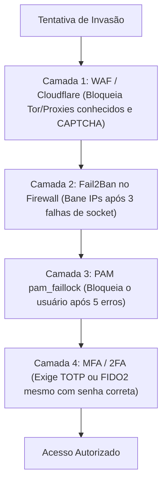

# 🛡️ 07 - Mitigações e Hardening Blue Team

> [!abstract] Objetivo do Módulo
> Implementar os controles de defesa necessários para neutralizar as vulnerabilidades exploradas nos laboratórios anteriores, abrangendo bloqueio de conta a nível de sistema operacional (PAM), filtragem dinâmica de tráfego (Fail2Ban), proteção de compartilhamentos SMB e autenticação multifator.

---

## 1. Bloqueio de Contas no Linux com PAM (`pam_faillock`)

Para impedir que atacantes continuem testando milhares de senhas contra uma conta:

Arquivo: `/etc/pam.d/common-auth`
```pam
auth required pam_faillock.so preauth audit silent deny=5 unlock_time=900
auth [default=1 success=ignore] pam_unix.so nullok_secure
auth [default=die] pam_faillock.so authfail audit deny=5 unlock_time=900
auth sufficient pam_faillock.so authsucc
```

- `deny=5`: Limite de 5 tentativas consecutivas incorretas.
- `unlock_time=900`: Conta congelada por 15 minutos (900s).

Para verificar e desbloquear contas manualmente como administrador:
```bash
# Ver falhas de um usuário
faillock --user msfadmin

# Desbloquear conta manualmente
faillock --user msfadmin --reset
```

---

## 2. Rate Limiting de Rede com Fail2Ban

O **Fail2Ban** monitora `/var/log/vsftpd.log` e cria regras dinâmicas no `iptables`.

Arquivo: `/etc/fail2ban/jail.local`
```ini
[vsftpd]
enabled  = true
port     = ftp,ftp-data,ftps,ftps-data
filter   = vsftpd
logpath  = /var/log/vsftpd.log
maxretry = 3
findtime = 600
bantime  = 3600
```

> [!success] Comportamento Defensivo
> O IP atacante que falhar 3 vezes em 10 minutos terá seus pacotes descartados (`DROP`) no firewall por 1 hora.

---

## 3. Hardening do Servidor Samba / SMB

Arquivo: `/etc/samba/smb.conf`
```ini
[global]
    # Desabilitar o protocolo inseguro e vulnerável SMBv1
    server min protocol = SMB2_10
    client min protocol = SMB2_10

    # Forçar assinatura de pacotes (impede Man-in-the-Middle e retransmissão NTLM)
    server signing = mandatory

    # Bloquear sessões nulas (Null Sessions) e enumeração anônima
    restrict anonymous = 2
    map to guest = Never
```

Reiniciar o serviço:
```bash
sudo systemctl restart smbd
```

---

## 4. Matriz de Defesa em Profundidade (*Defense in Depth*)



---

## 5. Simulação Didática do Bloqueador em Python

O repositório inclui o script interativo `scripts/defense_rate_limiter.py` que demonstra a lógica de defesa:

```bash
python3 scripts/defense_rate_limiter.py
```

> [!example] Saída do Simulador
> ```text
> [REQ] IP 192.168.56.102 tentando login para o usuário 'admin'...
>   [FALHA] Credencial inválida. Falhas consecutivas para 'admin': 1/3
> [REQ] IP 192.168.56.102 tentando login para o usuário 'admin'...
>   [FALHA] Credencial inválida. Falhas consecutivas para 'admin': 2/3
> [REQ] IP 192.168.56.102 tentando login para o usuário 'admin'...
>   [MITIGAÇÃO ATIVADA] Limite excedido! Conta 'admin' BLOQUEADA por 15 segundos.
> [REQ] IP 192.168.56.102 tentando login para o usuário 'admin'...
>   [BLOQUEIO] Conta 'admin' está TEMPORARIAMENTE BLOQUEADA! Tente em 14s.
> ```

---

## 🔗 Retornar ao Início
- Voltar para o Dashboard: [[MOC - Brute Force com Medusa]]
