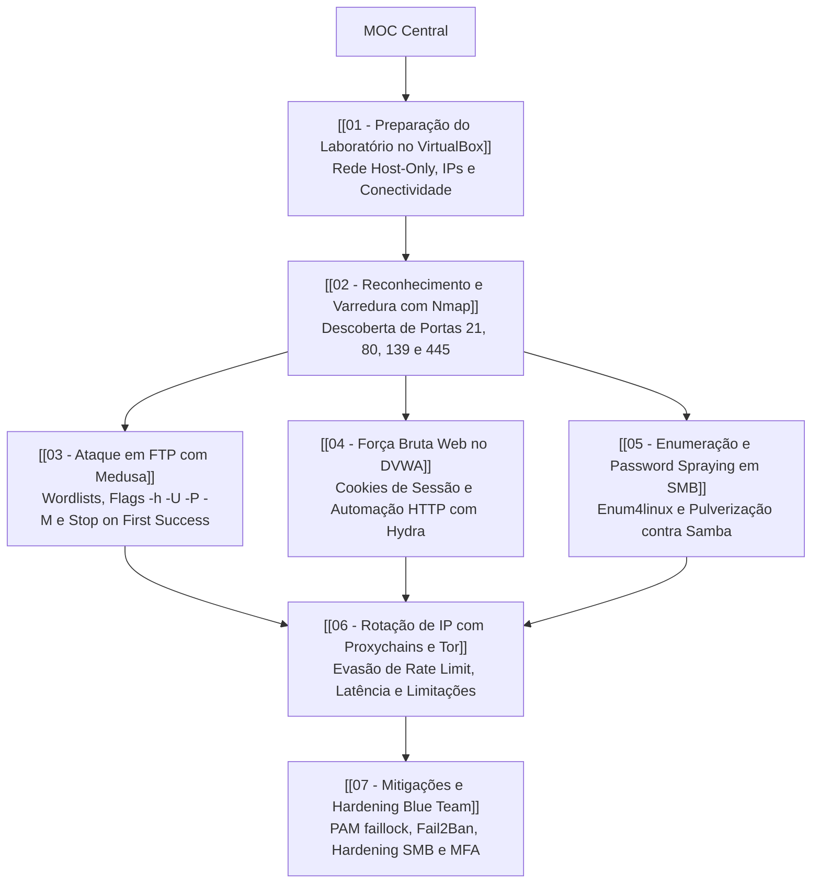

# 🛡️ MOC: Simulação de Brute Force com Medusa e Kali Linux

> **Bootcamp Santander Cibersegurança - DIO**  
> **Autor:** Lucas Rolim ([@lucasrolim96](https://github.com/lucasrolim96))  
> **Ambiente:** Kali Linux (Atacante) x Metasploitable 2 (Alvo) via VirtualBox

---

## 📌 Visão Geral do Laboratório

Este Map of Content (MOC) centraliza todas as anotações técnicas, evidências visuais e procedimentos práticos realizados durante a simulação de ataques de quebra de credenciais (Força Bruta, Ataque de Dicionário, Password Spraying e Evasão via Proxies), bem como as estratégias de defesa (*Blue Team*).

---

## 🗺️ Mapa de Conteúdo e Fluxo de Aprendizado



---

## 📋 Checklist de Execução do Laboratório

- [x] **Ambiente Virtual:** Criação de rede Host-Only no VirtualBox (`192.168.56.0/24`).
- [x] **Conectividade:** Teste de ping bidirecional entre Kali e Metasploitable 2.
- [x] **Reconhecimento:** Scan direcionado no Nmap mapeando vsftpd, Apache e Samba.
- [x] **Cenário 1 (FTP):** Quebra de credencial `msfadmin:msfadmin` com Medusa em 1.4s.
- [x] **Cenário 2 (DVWA):** Mapeamento de formulário web GET com cookies no DVWA via Hydra.
- [x] **Cenário 3 (SMB):** Enumeração de contas com `enum4linux` e Password Spraying sem bloqueio.
- [x] **Módulo Avançado:** Rotação de nós com Proxychains e Tor (`proxychains4`).
- [x] **Defesa e Mitigação:** Implementação de `pam_faillock`, jail no Fail2Ban e hardening no Samba.

---

## 📂 Navegação Rápida pelas Notas

| Ordem | Título da Nota | Foco Principal | Ferramentas Utilizadas |
| :---: | :--- | :--- | :--- |
| **01** | [[01 - Preparação do Laboratório no VirtualBox]] | Configuração de rede e isolamento | VirtualBox, `ifconfig`, `ip a`, `ping` |
| **02** | [[02 - Reconhecimento e Varredura com Nmap]] | Descoberta de serviços e banners | `nmap`, NSE Scripts |
| **03** | [[03 - Ataque em FTP com Medusa]] | Dicionário rápido em FTP | `medusa`, `ftp` |
| **04** | [[04 - Força Bruta Web no DVWA]] | Formulários web com controle de sessão | `hydra`, DevTools, DVWA |
| **05** | [[05 - Enumeração e Password Spraying em SMB]] | Ataque corporativo sem bloquear contas | `enum4linux`, `medusa`, `smbclient` |
| **06** | [[06 - Rotação de IP com Proxychains e Tor]] | Evasão de rate limiting e análise de latência | `proxychains4`, `tor` |
| **07** | [[07 - Mitigações e Hardening Blue Team]] | Contramedidas de proteção e monitoramento | `pam_faillock`, `fail2ban`, `smb.conf` |

---

## 🖼️ Galeria de Evidências (`attachments/`)

Quando salvar as capturas de tela das máquinas virtuais na pasta `attachments/`, o Obsidian renderizará automaticamente os painéis abaixo:

```text
attachments/
├── 01_virtualbox_network.png    # Placa de rede Host-Only
├── 02_nmap_scan_result.png      # Varredura Nmap
├── 03_medusa_ftp_success.png    # Sucesso no FTP
├── 04_dvwa_bruteforce_form.png  # Formulário web DVWA
├── 05_smb_password_spraying.png # Spraying SMB
└── 06_proxychains_terminal.png  # Conexão Tor / Proxychains
```
